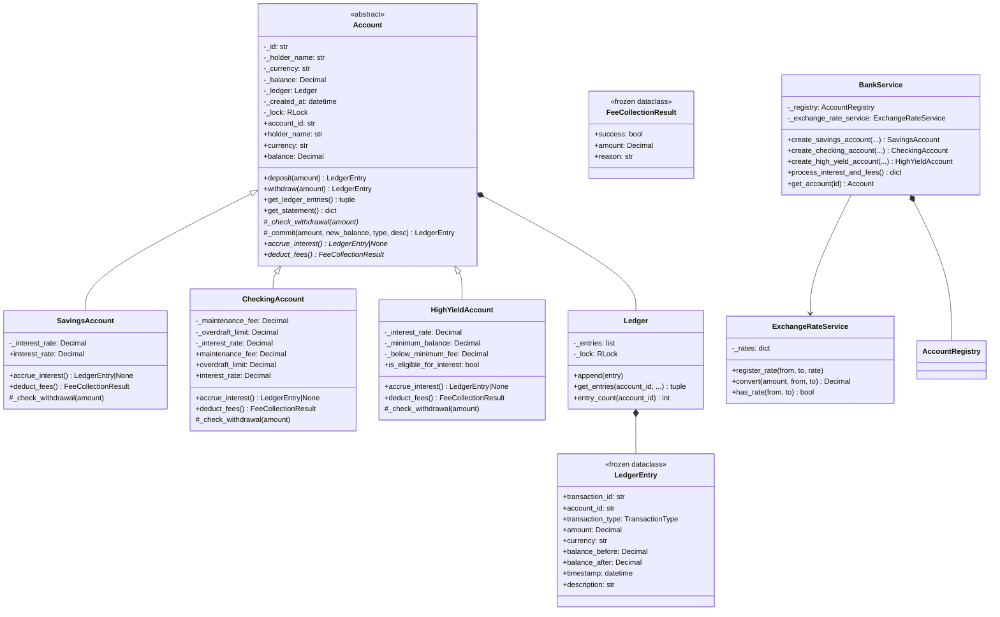

# Multi-Currency Banking & Ledger Engine

A complete, production-quality **Python 3.11+** banking ledger engine that
demonstrates the four pillars of object-oriented programming through a
realistic banking domain.

> **Disclaimer** — All interest rates, fees, and thresholds in this project
> are demonstration defaults only. This is not a real bank product, financial
> advice, or a production-grade system.

---

## Internship Projects
- **Task 1: Multi-Currency Banking & Ledger Engine** (documented below)
- **Task 2: [SOLID Notification & Alert Dispatch Framework](task-2-notification-dispatch/README.md)**

---

## Table of Contents

- [Task 1: Multi-Currency Banking & Ledger Engine](#project-overview)
- [Task 2: SOLID Notification & Alert Framework](task-2-notification-dispatch/README.md)

1. [Project Overview](#project-overview)
2. [OOP Pillars Demonstrated](#oop-pillars-demonstrated)
3. [Architecture & Class Relationships](#architecture--class-relationships)
4. [Account-Type Behaviour](#account-type-behaviour)
5. [Currency & Monetary Precision](#currency--monetary-precision)
6. [Ledger Design](#ledger-design)
7. [Interest & Fee Policies](#interest--fee-policies)
8. [Transaction Atomicity](#transaction-atomicity)
9. [Installation](#installation)
10. [Usage Examples](#usage-examples)
11. [Running Tests](#running-tests)
12. [Sample Output](#sample-output)
13. [Known Limitations](#known-limitations)
14. [Future Improvements](#future-improvements)
15. [Requirement Checklist](#requirement-checklist)

---

## Project Overview

The engine provides:

- An **abstract `Account` base class** with a concrete atomic-commit
  mechanism shared by all subclasses.
- Three **concrete account types**: `SavingsAccount`, `CheckingAccount`,
  and `HighYieldAccount`, each with distinct interest, fee, and overdraft
  policies.
- A **thread-safe, append-only financial ledger** that stores immutable
  `LedgerEntry` frozen dataclasses.
- **Multi-currency support** (INR, USD, EUR, GBP) with `decimal.Decimal`
  arithmetic and `ROUND_HALF_UP` rounding — no `float` touches any monetary
  calculation.
- An **explicit `ExchangeRateService`** — rates must be registered before
  conversion; the engine never invents exchange rates.
- A **`BankService`** that acts as a factory, registry, and polymorphic
  interest/fee processor.
- **Statement generation** with filtering, aggregation, and export to JSON
  and CSV.
- A **`pytest` test suite** with ≥ 100 test cases covering all 20 required
  scenarios including concurrent safety and atomic rollback.

---

## OOP Pillars Demonstrated

### 1. Abstraction
`Account` is declared with `abc.ABC`. The methods `accrue_interest()` and
`deduct_fees()` are `@abstractmethod`s — the interpreter prevents
instantiation of `Account` itself and forces every subclass to provide a
concrete implementation.

```python
from banking import Account  # Cannot be instantiated directly
# TypeError: Can't instantiate abstract class Account …
```

### 2. Encapsulation
All sensitive state is private:

| Private attribute   | Access path                   |
|---------------------|-------------------------------|
| `_balance`          | `account.balance` (read-only) |
| `_id`               | `account.account_id`          |
| `_ledger`           | `account.get_ledger_entries()` returns immutable tuple |
| `_interest_rate`    | `account.interest_rate`       |

The ledger is never exposed as a list; `get_ledger_entries()` returns a
`tuple[LedgerEntry, ...]`. `LedgerEntry` is a `frozen=True` dataclass —
mutation raises `FrozenInstanceError` at the interpreter level.

### 3. Inheritance
`SavingsAccount`, `CheckingAccount`, and `HighYieldAccount` all inherit
from `Account`. They reuse `deposit()`, `withdraw()`, `_commit()`, and
`get_statement()` without duplication. Each subclass overrides only the
methods that differ:
- `_check_withdrawal()` — balance / overdraft policy.
- `accrue_interest()` — rate and eligibility logic.
- `deduct_fees()` — fee amount and collection policy.

### 4. Polymorphism
`BankService.process_interest_and_fees()` iterates over a list of `Account`
references and calls `accrue_interest()` / `deduct_fees()` without a single
`isinstance` check or conditional branch. Each account applies its own
rules through the shared interface.

```python
for account in all_accounts:
    interest_entry = account.accrue_interest()   # polymorphic
    fee_result     = account.deduct_fees()        # polymorphic
```

---

## Architecture & Class Relationships



---

## Account-Type Behaviour

| Feature              | SavingsAccount | CheckingAccount | HighYieldAccount |
|----------------------|:--------------:|:---------------:|:----------------:|
| Interest rate        | 3.5% (default) | 0.1% (default)  | 7.0% (default)   |
| Overdraft allowed    | No             | Yes (configurable) | No            |
| Maintenance fee      | None           | Yes (configurable) | None          |
| Below-minimum fee    | N/A            | N/A             | Yes (configurable) |
| Minimum balance      | None           | None            | 1 000 (default)  |
| Interest eligibility | Always (if balance > 0) | Always (if balance > 0) | Only if balance ≥ minimum |

---

## Currency & Monetary Precision

- **Supported currencies**: INR, USD, EUR, GBP (all with 2 decimal places).
- All monetary values are `decimal.Decimal` with `ROUND_HALF_UP`.
- Cross-currency arithmetic without a registered rate raises
  `CurrencyMismatchError`. The engine never invents rates.
- `ExchangeRateService.register_rate(from, to, rate)` stores the rate and
  its inverse. `convert()` raises if the pair is not registered.

```python
from decimal import Decimal
from banking import ExchangeRateService, CurrencyMismatchError

svc = ExchangeRateService()
# This would raise CurrencyMismatchError:
# svc.convert(Decimal("100"), "USD", "EUR")

svc.register_rate("USD", "EUR", Decimal("0.92"))
eur = svc.convert(Decimal("100.00"), "USD", "EUR")  # → Decimal("92.00")
```

---

## Ledger Design

Every successful financial operation produces one `LedgerEntry`:

```
LedgerEntry(
    transaction_id  = "uuid4",
    account_id      = "uuid4",
    transaction_type = TransactionType.DEPOSIT,
    amount          = Decimal("1000.00"),
    currency        = "INR",
    balance_before  = Decimal("5000.00"),
    balance_after   = Decimal("6000.00"),
    timestamp       = datetime(2026, 10, 22, 4, 0, 0, tzinfo=UTC),
    description     = "Salary credit",
)
```

- Entries are **frozen dataclasses** — mutation raises `FrozenInstanceError`.
- The ledger list is never exposed; callers receive immutable `tuple[LedgerEntry, ...]`.
- Failed operations produce **no ledger entry** and leave balances unchanged.
- A skipped fee is **not** a ledger entry; it is reported through
  `FeeCollectionResult` and is the caller's responsibility to log.

---

## Interest & Fee Policies

| Account        | Interest formula              | Fee policy                                      |
|----------------|-------------------------------|------------------------------------------------|
| SavingsAccount | `balance × rate` per period   | None                                            |
| CheckingAccount | `balance × rate` per period  | Monthly `maintenance_fee`; skipped if insufficient |
| HighYieldAccount | `balance × rate` per period (only if balance ≥ minimum) | `below_minimum_fee` when balance < minimum; skipped if insufficient |

**Insufficient-funds fee policy** (CheckingAccount and HighYieldAccount):
if the balance cannot cover the fee at collection time, the fee is
**not collected**, the balance remains unchanged, and **no ledger entry
is created**. The returned `FeeCollectionResult(success=False)` carries
the reason.

---

## Transaction Atomicity

The `_commit()` method guarantees that the balance update and the ledger
entry either **both succeed or neither takes effect**:

```
1. Construct LedgerEntry (pure computation, no side effects)
2. Capture old_balance = self._balance
3. Set self._balance = new_balance
4. Call self._ledger.append(entry)
   ↳ If append raises:
       self._balance = old_balance   ← rollback
       raise AtomicOperationError
```

All steps run while `self._lock` (a `threading.RLock`) is held, so no
other thread can observe an intermediate state.

> **Limitation**: This is an in-memory guarantee only. There is no
> write-ahead log, durable storage, or distributed transaction coordinator.
> A process crash between steps 3 and 4 would lose the operation.

---

## Installation

```bash
# Clone the repository
git clone https://github.com/<your-username>/banking-ledger-engine.git
cd banking-ledger-engine

# Create and activate a virtual environment (recommended)
python -m venv .venv
.venv\Scripts\activate        # Windows
# source .venv/bin/activate   # macOS / Linux

# Install with development dependencies
pip install -e ".[dev]"
```

**Requirements**: Python 3.11+, no third-party runtime dependencies.

---

## Usage Examples

```python
from decimal import Decimal
from banking import BankService, ExchangeRateService

# Create a bank instance
bank = BankService()

# Create accounts in different currencies
savings = bank.create_savings_account("Alice", "INR", Decimal("50000.00"))
checking = bank.create_checking_account(
    "Bob", "USD", Decimal("2000.00"),
    maintenance_fee=Decimal("12.00"),
    overdraft_limit=Decimal("500.00"),
)

# Deposit and withdraw
savings.deposit(Decimal("10000.00"), description="Salary")
checking.withdraw(Decimal("300.00"), description="Rent")

# Process interest and fees for all accounts (polymorphic)
results = bank.process_interest_and_fees()
for account_id, info in results.items():
    print(f"{info['holder']}: interest={info['interest_entry']}, "
          f"fee_success={info['fee_result']['success']}")

# Export statement
from banking import StatementExporter
StatementExporter.to_json(savings, "savings_statement.json")
StatementExporter.to_csv(savings, "savings_statement.csv")

# Currency conversion (explicit rates only)
fx = ExchangeRateService()
fx.register_rate("USD", "INR", Decimal("83.50"))
inr = fx.convert(Decimal("100.00"), "USD", "INR")  # Decimal("8350.00")
```

---

## Running Tests

```bash
# Run the full test suite
pytest tests/ -v --tb=short

# With coverage report
pytest tests/ -v --tb=short --cov=src/banking --cov-report=term-missing

# Run the demo
python examples/demo.py
```

---

## Sample Output

```
==============================================================
  Multi-Currency Banking & Ledger Engine — Demo
  NOTE: All values are demonstration defaults only.
  This is not a real bank product or financial advice.
==============================================================

──────────────────────────────────────────────────────────────
  1. Creating accounts
──────────────────────────────────────────────────────────────
  ✔ Savings   (INR): abcd1234…  Balance ₹50000.00
  ✔ Checking  (USD): ef567890…  Balance $2000.00
  ✔ HighYield (GBP): 12ab3456…  Balance £5000.00

──────────────────────────────────────────────────────────────
  4. Rejected transactions (demonstrated)
──────────────────────────────────────────────────────────────

  [SavingsAccount] Attempting to withdraw ₹999,999 (exceeds balance):
  ✗ Rejected → SavingsAccount does not permit overdraft. …

  [CheckingAccount] Attempting to withdraw $10,000 (exceeds balance + overdraft):
  ✗ Rejected → Withdrawal exceeds available balance including overdraft. …
```

*(Full output produced by `python examples/demo.py`)*

---

## Known Limitations

1. **In-memory only** — no persistence. A process crash loses all state.
2. **No durability guarantees** — `_commit()` is atomic within a Python
   process but provides no write-ahead log, journal, or crash recovery.
3. **No distributed locking** — `threading.RLock` protects a single process;
   multi-process deployments would require an external lock.
4. **Simple interest only** — compound interest is not implemented.
5. **No account archiving or closure**.
6. **Exchange rates are static** — no live rate feeds; rates must be
   registered manually and are not time-stamped.
7. **No audit trail for operational events** — skipped fees are returned
   to the caller but not persisted anywhere by the engine itself.

---

## Future Improvements

- Persistent storage backend (SQLite, PostgreSQL) with a proper migration
  strategy.
- Compound interest calculation.
- Scheduled periodic processing (cron or task queue).
- Account closure and archiving workflow.
- Live exchange-rate feed integration with time-stamped historical rates.
- REST API layer (FastAPI or Flask).
- Structured operational-event log separate from the financial ledger.
- Full audit trail with user/actor attribution.

---

## Requirement Checklist

| Requirement                         | File / Test                                   |
|-------------------------------------|-----------------------------------------------|
| Abstract base class                 | `src/banking/accounts.py` · `Account`         |
| `accrue_interest` / `deduct_fees`   | `accounts.py` · all three subclasses          |
| SavingsAccount                      | `accounts.py` · `SavingsAccount`              |
| CheckingAccount                     | `accounts.py` · `CheckingAccount`             |
| HighYieldAccount                    | `accounts.py` · `HighYieldAccount`            |
| Multi-currency (INR/USD/EUR/GBP)    | `currency.py` · `SUPPORTED_CURRENCIES`        |
| Decimal arithmetic                  | `currency.py` · `validate_amount`, `round_for_currency` |
| ExchangeRateService                 | `currency.py` · `ExchangeRateService`         |
| Encapsulation                       | `accounts.py` (private attributes + properties) |
| Immutable ledger entries            | `models.py` · `LedgerEntry(frozen=True)`      |
| Atomic commit with rollback         | `accounts.py` · `Account._commit()`           |
| Transaction types enum              | `models.py` · `TransactionType`               |
| FeeCollectionResult (not ledger)    | `models.py` · `FeeCollectionResult`           |
| Polymorphic processing              | `services.py` · `BankService.process_interest_and_fees()` |
| Statement generation                | `accounts.py` · `get_statement()`             |
| Filter by type / date               | `reporting.py` · `TransactionFilter`          |
| Summary totals                      | `reporting.py` · `SummaryCalculator`          |
| JSON / CSV export                   | `reporting.py` · `StatementExporter`          |
| pytest test suite                   | `tests/test_accounts.py` … `test_reporting.py` |
| Concurrent withdrawal safety        | `test_accounts.py` · `test_concurrent_withdrawals_*` |
| Atomic rollback test                | `test_transactions.py`, `test_ledger.py`      |
| Fee skip — no ledger entry          | `test_interest_and_fees.py` · `test_fee_collection_result_is_not_ledger_entry` |
| Rounding correctness                | `test_currency.py`, `test_interest_and_fees.py` |
| Demo script                         | `examples/demo.py`                            |
