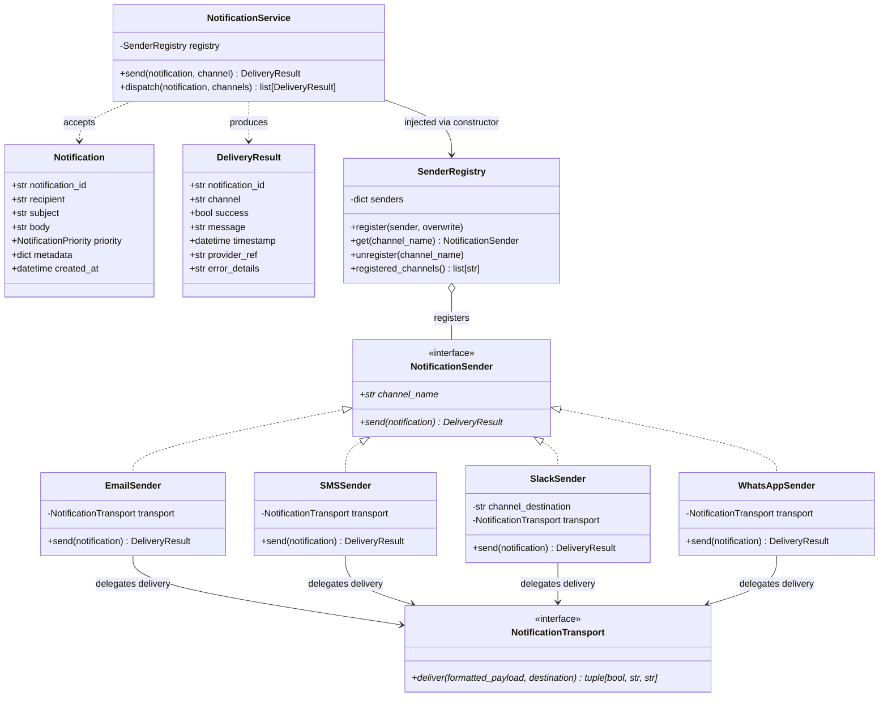

# Notification & Alert Dispatch Framework (Task 2)

An extensible, decoupled notification and alert dispatch engine adhering strictly to all five **SOLID Object-Oriented Design Principles**. Built for the **Datheon OOP & System Design Internship**.

[](https://www.python.org/downloads/)
[]()
[]()

---

## 1. Project Overview & Objectives

In modern distributed systems, services need to alert teams, trigger paging rotations, and notify end users across disparate communication channels—such as Email, SMS, Slack, and WhatsApp.

A naive implementation typically couples business logic directly to provider APIs, creates cascading `if/elif` statements, and leaks connection credentials across application layers.

This framework solves those challenges by providing:
- **Clean Abstractions**: Unified sender and transport interfaces using Python's `abc`.
- **Open/Closed Design**: Seamless introduction of new notification channels (e.g. Telegram, PagerDuty, Webhooks) without changing existing service logic.
- **Dependency Inversion**: High-level dispatch services depend solely on abstractions injected via constructors.
- **Zero External Dependencies / 100% Offline Testing**: Mockable transports and console transports ensure complete local testability without external network access or paid credentials.

---

## 2. Key Features

- **Multi-Channel Dispatching**: Native support for **Email**, **SMS**, **Slack**, and **WhatsApp**.
- **Immutable Value Models**: `Notification` and `DeliveryResult` built using frozen dataclasses with strict input validation.
- **Priority Escalation**: Typed priority levels (`LOW`, `NORMAL`, `HIGH`, `CRITICAL`).
- **Channel Registry**: Dynamic channel mapping with overwrite control and case-insensitive resolution.
- **Partial Failure Resilience**: Multi-channel broadcast (`dispatch()`) continues through downstream provider errors and returns detailed per-channel outcomes.
- **Standard Library Logging**: Audit-ready operational logging that carefully prevents leaking confidential message payloads or secrets.
- **Pure Validation**: Standalone, side-effect-free validators for email syntax, E.164 phone numbers, and Slack identifiers.

---

## 3. Folder Structure

```text
task-2-notification-dispatch/
├── src/
│   └── notifications/
│       ├── __init__.py               # Public API exports
│       ├── models.py                 # Notification, DeliveryResult, Priority
│       ├── interfaces.py             # NotificationSender & NotificationTransport ABCs
│       ├── exceptions.py             # Custom exception hierarchy
│       ├── service.py                # NotificationService (orchestration)
│       ├── registry.py               # SenderRegistry (dynamic mapping)
│       ├── validators.py             # Pure regex & syntax validation functions
│       └── channels/
│           ├── __init__.py           # Channel exports
│           ├── email.py              # EmailSender & ConsoleEmailTransport
│           ├── sms.py                # SMSSender & ConsoleSMSTransport
│           ├── slack.py              # SlackSender & ConsoleSlackTransport
│           └── whatsapp.py           # WhatsAppSender & ConsoleWhatsAppTransport
├── tests/
│   ├── __init__.py
│   ├── test_models.py                # Model validation & immutability tests
│   ├── test_interfaces.py            # Contract & ABC enforcement tests
│   ├── test_channels.py              # Sender & transport unit tests
│   ├── test_registry.py              # SenderRegistry lifecycle tests
│   ├── test_service.py               # Dispatch orchestration & DI tests
│   └── test_solid_principles.py      # Formal programmatic SOLID verification
├── examples/
│   └── demo.py                       # Standalone offline demonstration script
├── pyproject.toml                    # Package metadata & pytest configuration
├── .gitignore                        # Python & test artifact exclusion rules
└── README.md                         # Architecture and usage documentation
```

---

## 4. Architecture & Class Diagram

The framework decouples high-level orchestration from channel formatting and low-level transport mechanics.



---

## 5. Demonstration of the Five SOLID Principles

| Principle | Meaning & Architectural Application | Implementation Reference |
| :--- | :--- | :--- |
| **S — Single Responsibility** | A class should have one, and only one, reason to change. Data representation (`Notification`), orchestration (`NotificationService`), payload formatting (`EmailSender`), delivery mechanics (`ConsoleEmailTransport`), and syntax checks (`validators.py`) are strictly partitioned. | [`src/notifications/models.py`](src/notifications/models.py)<br>[`src/notifications/service.py`](src/notifications/service.py)<br>[`src/notifications/validators.py`](src/notifications/validators.py) |
| **O — Open/Closed** | Software entities should be open for extension, but closed for modification. New communication channels (e.g. `PagerDutySender` or `PushNotificationSender`) can be implemented and registered at runtime without editing a single line in `NotificationService`. | [`src/notifications/registry.py`](src/notifications/registry.py)<br>[`tests/test_solid_principles.py`](tests/test_solid_principles.py#L65) |
| **L — Liskov Substitution** | Subtypes must be substitutable for their base types without altering system correctness. Every channel sender satisfies the `NotificationSender` contract, captures errors into a standard `DeliveryResult`, and never throws uncaught transport errors. | [`src/notifications/interfaces.py`](src/notifications/interfaces.py#L43)<br>[`tests/test_solid_principles.py`](tests/test_solid_principles.py#L120) |
| **I — Interface Segregation** | Clients should not be forced to depend upon methods they do not use. `NotificationSender` is minimal, exposing only `channel_name` and `send()`. There are no forced methods for attachments, batching, authentication, or lifecycle events. | [`src/notifications/interfaces.py`](src/notifications/interfaces.py)<br>[`tests/test_solid_principles.py`](tests/test_solid_principles.py#L165) |
| **D — Dependency Inversion** | High-level modules should not depend on low-level modules; both should depend on abstractions. `NotificationService` depends solely on `SenderRegistry` and `NotificationSender` interfaces. Concrete senders are injected, and `service.py` contains zero imports of concrete channel classes. | [`src/notifications/service.py`](src/notifications/service.py#L25)<br>[`tests/test_solid_principles.py`](tests/test_solid_principles.py#L190) |

---

## 6. Installation & Environment Setup

This framework requires **Python 3.11+**.

Navigate to the Task 2 directory:
```bash
cd task-2-notification-dispatch
```

Install the package in editable mode with test dependencies:
```bash
pip install -e ".[dev]"
```

---

## 7. Quickstart Usage Example

```python
from notifications import (
    Notification,
    NotificationPriority,
    NotificationService,
    SenderRegistry,
)
from notifications.channels import (
    ConsoleEmailTransport,
    ConsoleSlackTransport,
    EmailSender,
    SlackSender,
)

# 1. Configure registry with desired channel senders and transports
registry = SenderRegistry()
registry.register(EmailSender(transport=ConsoleEmailTransport()))
registry.register(SlackSender(channel_destination="#ops", transport=ConsoleSlackTransport()))

# 2. Inject registry into NotificationService
service = NotificationService(registry=registry)

# 3. Create an immutable Notification
alert = Notification(
    recipient="admin@datheon.io",
    subject="Database Disk Usage Warning",
    body="Partition /var/data reached 88% capacity.",
    priority=NotificationPriority.HIGH,
    metadata={"host": "db-node-01", "disk": "/var/data"},
)

# 4. Dispatch notification through email
result = service.send(alert, channel="email")
print(f"Delivered: {result.success} | Ref: {result.provider_ref}")

# 5. Broadcast to multiple channels with partial failure safety
slack_alert = Notification(
    recipient="#ops",
    subject="Deployment",
    body="Release 2.0 completed successfully.",
)
results = service.dispatch(slack_alert, channels=["slack", "email"])
for r in results:
    print(f"Channel {r.channel}: Success={r.success}")
```

---

## 8. How to Add a New Notification Channel (OCP)

Adding a new channel requires **zero edits** to existing framework code:

```python
from notifications.interfaces import NotificationSender, NotificationTransport
from notifications.models import DeliveryResult, Notification

class DiscordSender(NotificationSender):
    def __init__(self, transport: NotificationTransport) -> None:
        self._transport = transport

    @property
    def channel_name(self) -> str:
        return "discord"

    def send(self, notification: Notification) -> DeliveryResult:
        # 1. Format payload for Discord webhook
        payload = f"**{notification.subject}**\n{notification.body}"
        
        # 2. Deliver via injected transport
        success, msg, ref = self._transport.deliver(payload, notification.recipient)
        
        # 3. Return structured DeliveryResult
        return DeliveryResult(
            notification_id=notification.notification_id,
            channel=self.channel_name,
            success=success,
            message=msg,
            provider_ref=ref,
        )

# Register into the service at runtime:
registry.register(DiscordSender(transport=my_discord_transport))
service.send(notification, channel="discord")  # Works immediately!
```

---

## 9. Running the Automated Tests

Run the test suite using `pytest`:

```bash
cd task-2-notification-dispatch
pytest
```

Run with detailed verbose output and code coverage:
```bash
pytest -v --cov=notifications --cov-report=term-missing
```

### Test Suite Structure
1. `test_models.py`: Validates model creation, immutability, field validation, and UUID/timestamp defaults.
2. `test_interfaces.py`: Confirms abstract base class enforcement and instantiation rules.
3. `test_channels.py`: Verifies all 4 senders (Email, SMS, Slack, WhatsApp), phone/email validation, error trapping, and console transports.
4. `test_registry.py`: Tests sender registration, overwrite controls, case-insensitive lookups, and unregistration.
5. `test_service.py`: Tests single-send, multi-channel dispatch, partial success, total failure, and logging safeguards.
6. `test_solid_principles.py`: Explicit programmatic validation of SRP, OCP, LSP, ISP, and DIP.

---

## 10. Running the Offline Demonstration

Run the standalone interactive demo:

```bash
python examples/demo.py
```

The script runs completely offline using local console transports and illustrates all core capabilities:
- Notification model generation
- Registration of standard and custom channels
- Multi-channel delivery
- Graceful handling of invalid recipients and unregistered channels

---

## 11. Error-Handling Contract

The framework distinguishes between configuration errors, user errors, and downstream transport failures:

- **`InvalidNotificationError`**: Raised immediately during `Notification` construction if required fields (recipient, subject, body) are empty or invalid types.
- **`UnsupportedChannelError`**: Raised by `service.send()` if a requested channel is not registered. (In `service.dispatch()`, this is converted into a failed `DeliveryResult` for non-blocking multi-target execution).
- **`SenderConfigurationError`**: Raised during sender initialization if static parameters (such as a default Slack channel identifier) are invalid.
- **`DeliveryError`**: Captured by channel senders when a transport throws an exception, guaranteeing `sender.send()` always returns a structured `DeliveryResult(success=False)` rather than crashing calling services.

---

## 12. Known Limitations & Production Readiness

- **Console Transports**: The included transports (`ConsoleEmailTransport`, `ConsoleSMSTransport`, etc.) log payloads locally for development and testing. They do not connect to external gateways (e.g. AWS SES, Twilio, Slack API, Meta Graph API).
- **Future Production Adapters**: To integrate real external providers, implement `NotificationTransport`:
  ```python
  class TwilioSMSTransport(NotificationTransport):
      def __init__(self, account_sid: str, auth_token: str):
          self.client = twilio.rest.Client(account_sid, auth_token)

      def deliver(self, formatted_payload: str, destination: str):
          msg = self.client.messages.create(body=formatted_payload, to=destination, from_="+1...")
          return True, "Delivered via Twilio", msg.sid
  ```
  Inject this adapter into `SMSSender(transport=TwilioSMSTransport(...))` with zero changes to business logic.
